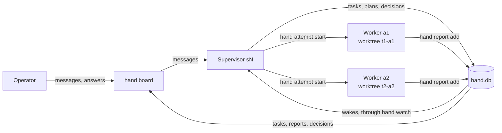

# How Hand works

Hand is built for one operator, not as a product for other users. It supports Linux, macOS and native Windows; [Platform support](platforms.md) says how each part is verified. The design and its non-goals are in [`docs/spec.md`](spec.md), and every term used here is defined in [`docs/vocabulary.md`](vocabulary.md).

The idea of one agent running a crew of workers in worktrees is also the idea behind [firstmate](https://github.com/kunchenguid/firstmate). Hand keeps the supervisor, the fleet memory and the determinism, in one Go binary with few dependencies.

## Why

A single agent works well on one task. Running several at once leaves someone to:

- write each request down before work starts, so nothing lives only in chat;
- keep concurrent work in separate worktrees and branches;
- know which worker is running, blocked, quiet or finished, without watching terminals;
- keep plans, reports and decisions when a chat session ends;
- ask the operator only when a choice is theirs;
- stop and clean up workers without losing uncommitted work.

In Hand, the supervisor handles judgement and `hand` handles the mechanics. Workflow state lives in a state machine over SQLite, never in an agent's memory, so a fresh supervisor orients from `hand orient` alone. Waiting costs no tokens: a watcher wakes the supervisor only when something changed, when a timer it armed comes due, or when it idles while nothing watches its active tasks.

## The daily loop

What you do:

1. Open the fleet's page with `hand open`. The **Needs** tab lists what waits on you: open decisions, the supervisor's blocked screens, unread reports, failed, exited or interrupted attempts, a supervisor that idles with unwatched work, and a supervisor that stopped unexpectedly.
2. Ask for work in the **Chat** tab. The supervisor captures each request as a task before doing anything else.
3. Answer decisions on their card or their page, or with `hand decision answer dN "ANSWER"`.
4. Read reports, and press **Mark read** once you have read one.
5. Follow a task on its page, or open its newest deliverable with `hand open tN --delivered`.
6. Find a task with **Browse finished tasks** under the task list, or the search field above it. The Tasks page searches titles, goals and refs over every task: with a query it covers every status, and the Status filter narrows it to finished, active, inbox, done or abandoned. It also filters by project and by date (a date is a UTC day, shown when you hover the field), and groups the results by day, 50 to a page.

What the supervisor does, following the `secondhand` skill:

1. `hand orient`, at the start of every turn and after every wake.
2. Capture with `hand task add`, start with `hand task start tN`, and plan with `hand plan set --body-file PLAN.md tN`.
3. Start a worker with `hand attempt start --profile NAME --prompt-file BRIEF.md tN`.
4. Wait: wakes arrive as messages that start with `[hand v1 wake]`. For something outside Hand, such as a PR review, it arms a timer with `hand wake` (managed supervisors only; one opened by hand waits with `hand wait --timeout`). Before it ends a turn it runs `hand orient`, and it never ends one while tasks are `unwatched`.
5. Read reports with `hand report show rN`, act on them, and acknowledge them with `hand report ack rN`.
6. Ask you with `hand decision ask tN "QUESTION"`.
7. Verify the acceptance check, then `hand attempt stop aN` if the worker still runs, `hand attempt clean aN` and `hand task done tN`.

Routing profiles live in `<home>/routing.json`, and `hand route list` shows them. The starter has `quick`, `default`, `high`, `deep` and `max`: `claude` `sonnet` at rising effort.
